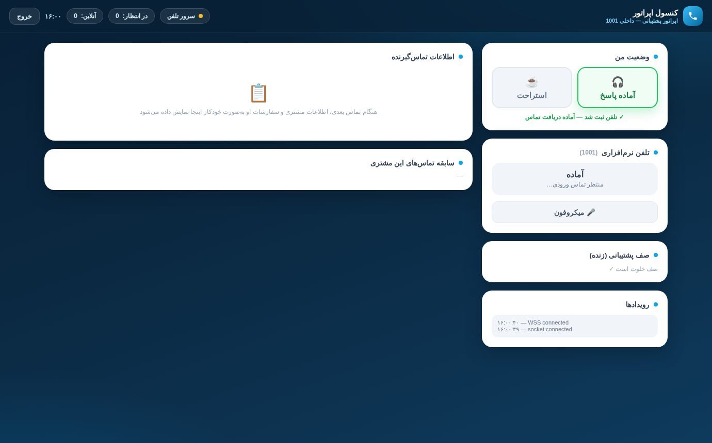
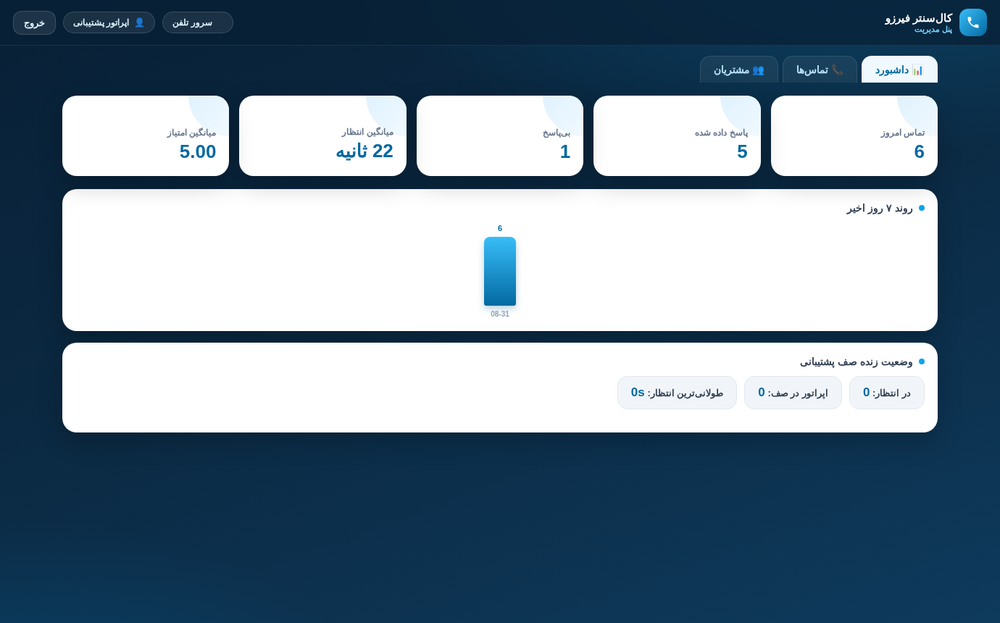
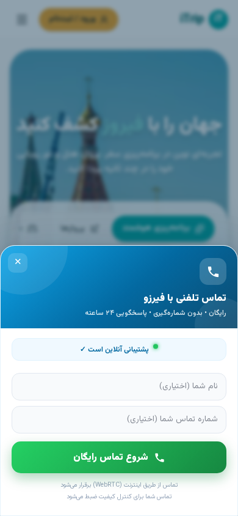

# callcenter-web

**کال‌سنتر تحت وب برای firuzo.online** — یک کال‌سنتر کامل self-hosted:
ویجت سبک جاوااسکریپت که دکمه‌های تماس **موجود** سایت را به تماس صوتی واقعی
(WebRTC) تبدیل می‌کند، پنل وب اپراتور و ادمین، و PBX بر پایه Asterisk با IVR،
صف، ضبط مکالمات و نظرسنجی رضایت.

> وضعیت: پروداکشن (v2.0.3) — در حال سرویس‌دهی زنده روی `call.firuzo.online`
> با ۶ داخلی اپراتور، IVR فارسی و اتصال CRM.

---

## محتویات ریپو

| بخش | مسیر | کارکرد |
|---|---|---|
| **ویجت** | `backend/public/widget.js` | فقط ۳۷KB، یک خط اسکریپت. دکمه‌های تماس موجود (`tel:` ، `[data-fz-call]` ، `.fz-call-trigger`) را هوک می‌کند، پرمیشن میکروفون را با راهنمای هر مرورگر می‌گیرد، تماس WebRTC/SIP برقرار می‌کند، جایگاه صف را نشان می‌دهد، امتیاز ۱ تا ۵ می‌گیرد و اگر مرورگر/دستگاه پشتیبانی نکرد **کارت شماره تلفن** جایگزین نشان می‌دهد (بن‌بست ندارد). |
| **بک‌اند** | `backend/` | Node.js (Express + Socket.IO): REST API پنل/ویجت، احراز JWT، کلاینت AMI به Asterisk، اسکیمای MySQL (کاربران، تماس‌ها، رخدادها، بازدیدکنندگان، نظرسنجی، تنظیمات)، اتصال **ریموت دیتابیس** برای CRM، و دریافت ضبط‌ها با SFTP. |
| **پنل اپراتور** | `backend/public/operator/` | تلفن وب با تم آبی شیشه‌ای: ورود، آماده/استراحت (عضویت خودکار صف)، مودال زنگ‌دار تماس ورودی + Notification مرورگر، پاپ‌آپ CRM کامل (مشخصات + سفارش‌ها + تماس‌های قبلی)، یادداشت، میوت، تایمر. |
| **پنل ادمین** | `backend/public/admin/` | کاشی‌های آمار، نمودار ۷روزه، صف زنده، جدول CDR با خروجی CSV و پخش ضبط، مدیریت اپراتورها، تنظیمات اتصال ریموت‌DB، وضعیت AMI. |
| **کانفیگ Asterisk** | `asterisk/conf/` | داخلی‌های WebRTC (visitor + 1000..1005)، دایل‌پلن (IVR → صف → نظرسنجی)، صف، AMI، RTP و HTTP/WS — به‌صورت **قالب** که نصب‌کننده رندر می‌کند. |
| **صداهای IVR** | `asterisk/sounds/fa/custom/` | پیام‌های فارسی (خوش‌آمد، انتظار صف، نظرسنجی، …) + اسکریپت تولید صدا در `scripts/`. |
| **Worker کلادفلر** | `worker/fz-call-widget-edge.js` | کش لبه برای `widget.js` با کلید نسخه؛ هر دیپلوی بلافاصله در لبه رفرش می‌شود. |
| **نصب‌کننده** | `installer/` | `install.sh` (idempotent و قالب‌محور) + `check.sh` (بررسی‌کننده دقیق با ۳ حالت) + `config.example.conf`. |
| **CI** | `.github/workflows/` | برای هر بخش یک گیت‌اکشن + مانیتور زمان‌بندی‌شده سرویس زنده. |

## مسیر تماس

```
بازدیدکننده (سایت)                                اپراتور (پنل)
  کلیک روی دکمه تماس موجود                          ورود + آماده
        │ widget.js v2                                    │ SIP روی WSS
        ▼                                                 ▼
  wss://call.<domain>/ws ──nginx──►            ┌──────────────────┐
                                               │  Asterisk (PBX)  │
                                               │  IVR → صف        │──► ضبط (.wav)
                                               └──────┬───────────┘
                                                      │ رخدادهای AMI
                                                      ▼
                                        ┌─────────────────────────┐
                                        │ بک‌اند Node (API+Socket) │──► MySQL (CDR/CRM)
                                        └──────────┬──────────────┘
                                                   │ اتصال فقط-خواندنی
                                                   ▼
                                        دیتابیس CRM ریموت (پاپ‌آپ سفارش‌ها)
```

۱. بازدیدکننده دکمه تماس سایت را می‌زند → ویجت باز می‌شود (بات‌شیت در موبایل، کارت در دسکتاپ).
۲. پرمیشن میکروفون با راهنمای مشخص هر مرورگر گرفته می‌شود؛ در صورت رد/عدم پشتیبانی، کارت شماره تلفن جایگزین می‌شود.
۳. SIP.js (لود تنبل) به‌عنوان `visitor` ثبت و به داخلی تعریف‌شده زنگ می‌زند.
۴. Asterisk IVR فارسی را پخش، بازدیدکننده را به صف `support` می‌برد و تماس را ضبط می‌کند.
۵. پنل اپراتور با پاپ‌آپ CRM کامل زنگ می‌خورد (اتصال ریموت‌DB سفارش‌های مشتری را نشان می‌دهد).
۶. پس از تماس، IVR امتیاز ۱–۵ می‌پرسد؛ نتیجه در CDR و داشبورد ادمین می‌نشیند.

## شروع سریع (سرور تازه)

```bash
git clone https://github.com/<you>/callcenter-web.git
cd callcenter-web

# ۰) اول ببین، بعد دست بزن — گزارش فقط-خواندنی از محیط
sudo installer/check.sh --config <(sed installer/config.example.conf -e 's/call\.firuzo\.online/call.yourdomain.com/') --preflight

# ۱) کانفیگ
cp installer/config.example.conf my.conf
vi my.conf                       # دامنه، IPها، رمزها (خالی = تولید خودکار)

# ۲) نصب نقش‌های همین ماشین
sudo installer/install.sh --config my.conf            # تشخیص خودکار نقش
sudo installer/install.sh --config my.conf --only pbx,turn,app,nginx

# ۳) راستی‌آزمایی دقیق
sudo installer/check.sh --config my.conf --full --pbx --app --nginx --turn

# ۴) DNS (کلادفلر: رکورد A، پروکسی‌شده) و امبد ویجت:
#    <script src="https://call.yourdomain.com/widget.js" defer></script>
```

راهنمای کامل (کلادفلر، جداسازی PBX/app، گواهی): **docs/INSTALL-FA.md**

## بررسی‌کننده — سه حالت دقیق

```bash
installer/check.sh --selftest              # حالت CI: خودِ بسته ریپو را اعتبارسنجی می‌کند
sudo installer/check.sh --config my.conf --preflight          # گزارش فقط-خواندنی سرور
sudo installer/check.sh --config my.conf --full --pbx --app --nginx --turn
```

حالت `--full` سرویس‌ها، پورت‌ها، هدر CORS (باگ اصلی «دکمه کار نمی‌کند»)، هندشیک
WSS (انتظار `101`)، شنونده AMI، اسکیمای DB، صداهای فارسی، پنل اپراتور/ادمین،
`widget.js`، دایرکتوری ضبط و URL عمومی را چک می‌کند؛ با هر FAIL کد خروج ناصفر
می‌دهد — مناسب cron/مانیتورینگ.

## CI — از وضعیت هر بخش باخبر باشید

| Workflow | پایش |
|---|---|
| `01-widget` | سینتکس، هوک‌های الزامی (اتصال به دکمه‌های موجود، JS API، جریان پرمیشن)، سقف ۶۰KB |
| `02-backend` | سینتکس JS، نصب وابستگی‌ها، لود شدن libها، سلامت اسکیما |
| `03-panels` | سیم‌کشی الزامی پنل اپراتور/ادمین (viewport ، socket.io ، اندپوینت‌ها) |
| `04-asterisk` | رندر قالب‌ها، سازگاری endpoint/auth/aor، دایل‌پلن ↔ صدا ↔ صف، سالم بودن modules.conf |
| `05-installer` | shellcheck ، bash -n ، خودآزمایی کامل بسته، رندر خشک بدون placeholder جامانده |
| `06-docs` | وجود مستندات، سالم بودن لینک‌های نسبی، سازگاری VERSION ↔ CHANGELOG |
| `07-monitor` | **پینگ زمان‌بندی‌شده سرویس زنده** → به‌صورت خودکار issue حادثه باز/بسته می‌کند |

متغیر ریپو `CC_MONITOR_URL` (مثلاً `https://call.firuzo.online`) را تنظیم کنید.

## سطح پیکربندی (توسعه‌پذیری)

- **بک‌اند**: همه‌چیز با `backend/.env` (متغیرهای `CC_*` — نمونه در `.env.example`):
  پورت، آدرس عمومی، رمز JWT، اتصال DB، AMI، رمزهای SIP، سرورهای TURN، مسیر ضبط‌ها، برندینگ، شماره پشتیبانی.
- **PBX**: `asterisk/conf/*.tmpl` — رمز visitor/اپراتورها، کاربر AMI، IPهای داخلی.
- **رفتار ویجت**: از `/api/widget/config` کانفیگ ران‌تایم می‌گیرد (داخلی صف، ICE، برندینگ) — بدون rebuild قابل تغییر.
- **پنل‌ها**: توسط بک‌اند سرو می‌شوند؛ آپدیت زنده با اتاق‌های Socket.IO (`admin` ، `operators` ، `op:<ext>`).
- **کانکتور CRM**: پنل ادمین → تنظیمات ریموت‌DB (پیش‌فرض MySQL فقط-خواندنی؛ برای موتورهای دیگر `backend/lib/remote.js` را گسترش دهید).
- **مقیاس‌پذیری**: افزودن داخلی اپراتور در `pjsip.conf.tmpl` + بازه `SIP_CREDS` بک‌اند؛ استراتژی صف در `queues.conf`؛ IVR در `extensions.conf.tmpl`؛ تولید مجدد صداها با `scripts/generate-ivr-audio.mjs`.

## نکات امنیتی

- رمزهای پیش‌فرض برای دیپلوی مرجع وجود دارند و در `installer/config.example.conf`
  آمده‌اند — برای هر نصب جدید **حتماً عوضشان کنید** (مقادیر خالی به‌صورت خودکار
  تولید و در `/opt/callcenter/.generated-creds` با دسترسی 600 ذخیره می‌شوند).
- PBX هرگز نباید مستقیم روی اینترنت بیفتد: WSS روی nginx/کلادفلر خاتمه می‌یابد،
  AMI فقط LAN است و TURN تنها جزء رسانه‌ای رو به اینترنت.
- این ریپو را **private** نگه دارید (رمزهای پیش‌فرض دیپلوی مرجع در کد هست) یا
  پیش از عمومی‌کردن همه رمزها را بچرخانید.

## مستندات
- [راهنمای آپدیت و انتشار (بستهٔ نصبی قابل‌آپدیت)](docs/UPDATE-FA.md)


- 📖 **منوال کامل کاربری (فارسی)**: [docs/USER-MANUAL-FA.md](docs/USER-MANUAL-FA.md)
- 🛠 راهنمای نصب (فارسی): [docs/INSTALL-FA.md](docs/INSTALL-FA.md)
- 🔗 اتصال ویجت به دکمه‌های موجود (فارسی): [docs/INTEGRATION-FA.md](docs/INTEGRATION-FA.md)
- 🚑 عیب‌یابی (فارسی): [docs/TROUBLESHOOTING-FA.md](docs/TROUBLESHOOTING-FA.md)
- 🏗 معماری و نقاط توسعه (انگلیسی): [docs/ARCHITECTURE.md](docs/ARCHITECTURE.md)
- تغییرات: [CHANGELOG.md](CHANGELOG.md)

## اسکرین‌شات‌ها

| پنل اپراتور | داشبورد ادمین | ویجت (موبایل) |
|---|---|---|
|  |  |  |

## لایسنس

MIT — [LICENSE](LICENSE)
