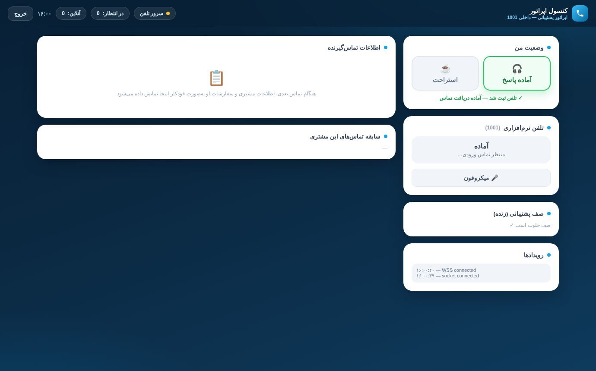
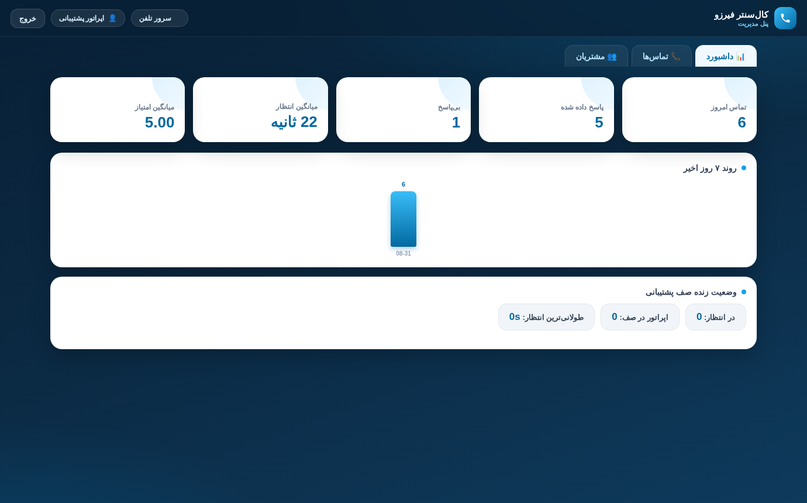
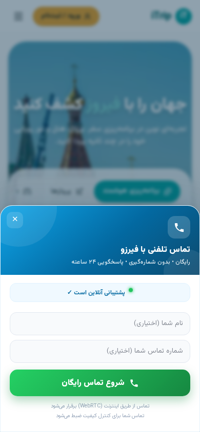

# callcenter-web

**Web Call Center for firuzo.online** — a complete, self-hosted web call center:
a lightweight JavaScript widget that turns your website's existing "Contact Us"
buttons into real voice calls (WebRTC), an operator + admin web panel, and an
Asterisk PBX with IVR, queue, call recordings and satisfaction surveys.

> Status: production (v2.0.3) — running the live deployment of
> `call.firuzo.online` with 6 operator extensions, Persian IVR and CRM lookup.

---

## What is inside

| Component | Path | What it does |
|---|---|---|
| **Widget** | `backend/public/widget.js` | 37 KB single-script embed. Renders a beautiful launcher, hooks your **existing** contact buttons (`tel:` links, `[data-fz-call]`, `.fz-call-trigger`), asks for mic permission with per-browser recovery guidance, places a WebRTC call over SIP/WSS, shows queue position, handles the 1–5 rating step, falls back to a phone card when WebRTC is unavailable. |
| **Backend** | `backend/` | Node.js (Express + Socket.IO). REST API for panels/widget, JWT auth, AMI client to Asterisk, MySQL/MariaDB schema (users, calls, call_events, visitors, surveys, settings), CRM enrichment via the **remote DB connector**, recording pull from the PBX over SFTP. |
| **Operator panel** | `backend/public/operator/` | Blue-glass themed web phone: login, ready/break (auto queue membership), ringing modal with browser notification, full CRM popup (visitor info + orders + past calls), notes, mute, timer, live Socket.IO updates. |
| **Admin panel** | `backend/public/admin/` | Stats tiles, 7-day chart, live queue board, CDR table with CSV export + recording playback, operator management, remote-DB connector settings, AMI status. |
| **Asterisk configs** | `asterisk/conf/` | PJSIP WebRTC endpoints (visitor + 1000–1005), dialplan (IVR → queue → survey), queue, AMI manager, RTP, HTTP/WS. Shipped as **templates** rendered by the installer. |
| **IVR sounds** | `asterisk/sounds/fa/custom/` | Persian IVR prompts (welcome, queue-wait, survey-intro, survey-thanks, …) + generator scripts in `scripts/`. |
| **Cloudflare Worker** | `worker/fz-call-widget-edge.js` | Edge-caches `widget.js` with a version key, so deployments refresh the edge instantly. |
| **Installer** | `installer/` | `install.sh` (idempotent, template-driven) + `check.sh` (precise verifier with three modes) + `config.example.conf`. |
| **CI** | `.github/workflows/` | One GitHub Action per component + a scheduled live service monitor. |

## Call flow

```
Visitor (firuzo.online)                       Operator (panel)
  taps existing "Contact Us" button              logs in, goes Ready
        │ widget.js v2                                 │ SIP over WSS
        │ mic permission → SIP INVITE                  ▼
        ▼                                    ┌──────────────────┐
  wss://call.<domain>/ws ──nginx──►          │  Asterisk (PBX)  │
                                             │  IVR → Queue     │──► recordings (.wav)
                                             └──────┬───────────┘
                                                    │ AMI events
                                                    ▼
                                       ┌─────────────────────────┐
                                       │ Node backend (API+Socket)│──► MySQL (CDR/CRM)
                                       └──────────┬──────────────┘
                                                  │ read-only connector
                                                  ▼
                                       remote CRM DB (orders popup)
```

1. Visitor clicks a contact button → widget opens (bottom-sheet on mobile, card on desktop).
2. Microphone permission requested with explicit per-browser guidance; if denied/unavailable
   the widget shows a **phone-number card** instead (no dead end).
3. SIP.js (lazy-loaded) registers as `visitor` and dials the configured extension.
4. Asterisk plays the Persian IVR, puts the visitor in the `support` queue, records the call.
5. Operator panel rings with a full CRM popup (remote DB connector shows the customer's orders).
6. After the call the IVR asks for a 1–5 rating; results land in CDR + admin dashboard.

## Quick start (fresh host)

```bash
git clone https://github.com/<you>/callcenter-web.git
cd callcenter-web

# 0) look before you touch — read-only environment report
sudo installer/check.sh --config <(sed installer/config.example.conf -e 's/call\.firuzo\.online/call.yourdomain.com/') --preflight

# 1) configure
cp installer/config.example.conf my.conf
vi my.conf                       # domain, IPs, passwords (empty = auto-generated)

# 2) install the roles this machine should run
sudo installer/install.sh --config my.conf            # auto-detects role
sudo installer/install.sh --config my.conf --only pbx,turn,app,nginx

# 3) verify everything, precisely
sudo installer/check.sh --config my.conf --full --pbx --app --nginx --turn

# 4) point the DNS (Cloudflare: A record, proxied) and embed the widget:
#    <script src="https://call.yourdomain.com/widget.js" defer></script>
```

Full walkthrough (incl. Cloudflare, split PBX/app hosts, certs): **docs/INSTALL-FA.md**.

## Verifier — three precise modes

```bash
installer/check.sh --selftest              # CI mode: validates the repo package itself
sudo installer/check.sh --config my.conf --preflight          # read-only host report
sudo installer/check.sh --config my.conf --full --pbx --app --nginx --turn
```

`--full` verifies services, ports, CORS header (the widget killer bug), WSS
handshake (expects `101`), AMI listener, DB schema, Persian sounds, operator
panel, admin panel, widget.js, recordings dir and the public URL. Exit code is
non-zero on any FAIL — safe for cron/monitoring.

## CI — know the status of every part

| Workflow | What it watches |
|---|---|
| `01-widget` | syntax, required hooks (existing-button integration, JS API, mic flow), 60 KB size budget |
| `02-backend` | JS syntax, deps install, lib require smoke, schema sanity |
| `03-panels` | operator/admin HTML required wiring (viewport, socket.io, endpoints) |
| `04-asterisk` | templates render, endpoint/auth/aor consistency, dialplan ↔ sounds ↔ queue, modules.conf intact |
| `05-installer` | shellcheck, bash -n, full repo selftest, placeholder-free dry render |
| `06-docs` | docs present, relative links resolve, VERSION ↔ CHANGELOG consistency |
| `07-monitor` | **scheduled probe of the LIVE service** → opens/closes an incident issue automatically |

Set the repo variable `CC_MONITOR_URL` (e.g. `https://call.firuzo.online`) to
point the monitor at your deployment.

## Configuration surface (extensibility)

- **Backend**: everything overridable via `backend/.env` (`CC_*` — see `.env.example`):
  port, public origin, JWT secret, DB host/user/pass/name, AMI, SIP passwords,
  TURN endpoints, recording paths, branding, support phone.
- **PBX**: `asterisk/conf/*.tmpl` — visitor/operator passwords, AMI user, LAN IPs.
- **Widget behavior**: fetches runtime config from `/api/widget/config` (queue
  extension, ICE servers, branding) — no rebuild needed to change it.
- **Panels**: served by the backend; live updates via Socket.IO rooms
  (`admin`, `operators`, `op:<ext>`).
- **CRM connector**: admin panel → remote DB settings (read-only MySQL by
  default; extend `backend/lib/remote.js` for other engines).
- **Scaling notes**: add operator extensions in `pjsip.conf.tmpl` + backend
  `SIP_CREDS` range; queue strategy in `queues.conf`; IVR in
  `extensions.conf.tmpl`; sounds regenerable via `scripts/generate-ivr-audio.mjs`.

## Security notes

- Default passwords exist for the reference deployment and are documented in
  `installer/config.example.conf` — **rotate them for any new install**
  (empty values in the config are auto-generated and stored in
  `/opt/callcenter/.generated-creds`, chmod 600).
- PBX must never be exposed to the internet: WSS terminates on nginx/Cloudflare,
  AMI listens on the LAN, TURN is the only internet-facing media component.
- Keep this repository **private** (it contains the reference deployment's
  default credentials) or rotate everything before making it public.

## Documentation
- [Update & release guide (updatable install package)](docs/UPDATE-FA.md)


- 🇮🇷 **User manual (complete)**: [docs/USER-MANUAL-FA.md](docs/USER-MANUAL-FA.md)
- 🇮🇷 Install guide: [docs/INSTALL-FA.md](docs/INSTALL-FA.md)
- 🇮🇷 Widget integration (existing buttons): [docs/INTEGRATION-FA.md](docs/INTEGRATION-FA.md)
- 🇮🇷 Troubleshooting: [docs/TROUBLESHOOTING-FA.md](docs/TROUBLESHOOTING-FA.md)
- 🇬🇧 Architecture & extension points: [docs/ARCHITECTURE.md](docs/ARCHITECTURE.md)
- Persian readme: [README.fa.md](README.fa.md)

## Screenshots

| Operator panel | Admin dashboard | Widget (mobile) |
|---|---|---|
|  |  |  |

## License

MIT — see [LICENSE](LICENSE).
